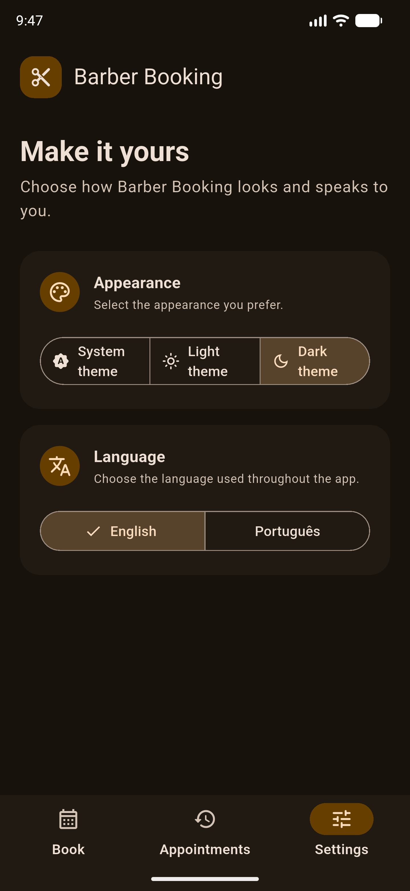

# Barber Booking

Portfolio-grade barbershop scheduling built as a modular ASP.NET MVC monolith with a Flutter client.

## Technology

- ASP.NET MVC 5 and ASP.NET Web API 2 on .NET Framework 4.8
- Entity Framework 6 and SQL Server
- Flutter with feature-first Clean Architecture
- Cubit, GetIt + Injectable, Dio, GoRouter, ARB localization
- English and Brazilian Portuguese
- System, light, and dark theme modes

## Repository layout

```text
src/
  backend/  ASP.NET MVC modular monolith and versioned API
  mobile/   Flutter application
```

## Screenshots

| Booking | Appointment history | Settings |
| --- | --- | --- |
|  |  |  |

## Architecture

The backend deploys as one application while keeping dependencies directed inward:

```text
Controller -> Application Service -> Domain Repository Contract
           -> Entity Framework Repository -> SQL Server
```

The Flutter application uses complete vertical slices:

```text
Page/Widget -> Cubit -> Use Case -> Repository Contract
            -> Repository Implementation -> Data Source -> API/storage
```

## Backend reliability

- Structured JSON request and exception logs include the HTTP method, path, status code, duration, and correlation ID.
- `X-Correlation-ID` is accepted from clients or generated by the API and returned in every response.
- A global exception filter returns a consistent, safe error contract without exposing implementation details.
- A fixed-window rate limiter protects the API per client IP. The default is 120 requests per minute and can be changed through `RateLimitPerMinute` in `Web.config`.
- Read-heavy service data is cached in memory for five minutes.
- Appointment history supports server-side pagination with a maximum page size of 100.

### Pagination

```http
GET /api/v1/appointments?page=1&pageSize=20
X-Correlation-ID: optional-client-correlation-id
```

Paginated responses include `items`, `page`, `pageSize`, `totalItems`, and `totalPages`. Rate-limited requests return HTTP `429` with a `Retry-After` header.

## Local setup

### Backend

1. Open `BarberBooking.sln` in Visual Studio.
2. Restore NuGet packages.
3. Update `BarberBookingConnection` in `src/backend/Web.config` if required.
4. Run the `BarberBooking.Backend` project with IIS Express.

LocalDB is the default development database. Entity Framework creates and seeds it on first use.

### Mobile

```bash
cd src/mobile
flutter pub get
dart run build_runner build --delete-conflicting-outputs
flutter gen-l10n
adb reverse tcp:59579 tcp:59579
flutter run --dart-define=API_BASE_URL=http://localhost:59579/api/v1
```

Alternatively, Android emulators can access the host through `10.0.2.2`.

## Validation

```bash
dotnet test tests/backend/BarberBooking.Backend.Tests/BarberBooking.Backend.Tests.csproj
cd src/mobile
flutter analyze
flutter test
```

Backend tests cover domain rules, application pagination, scheduling conflicts, caching, rate limiting, and the global error contract. Build the backend solution with Visual Studio or MSBuild for .NET Framework 4.8.

## Engineering conventions

All source code, identifiers, file names, folders, documentation, branches, and commit messages use English.
